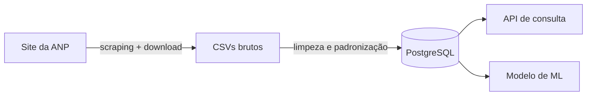

<h1 align="center">Olá, eu sou o Vitor 👋</h1>

  <b>Desenvolvedor Python · Foco em Engenharia de Dados</b>
   
  Pipelines ETL · SQL · Integração de dados · Docker
   
  📍 Goiânia - GO, Brasil · 🌎 Disponível para trabalho 100% remoto

  
  

---

## Sobre mim

Sou desenvolvedor Python e estou direcionando minha carreira para **engenharia de dados**. Nos meus trabalhos até aqui, cuidei da parte "invisível" dos sistemas: coletar dados de várias fontes, tratar, enfileirar, sincronizar e garantir que tudo chegue certo ao destino, rodando em containers em servidores Linux.

Venho da **automação industrial**. Antes do software, trabalhei com painéis elétricos, lógica de CLPs (Siemens/TIA Portal), parametrização de inversores de frequência e manutenção. Isso moldou meu jeito de trabalhar: diagnóstico metódico, documentação clara e sistemas que precisam funcionar de verdade, todo dia.

- 💼 Experiência mais recente: **Python Automation Software Developer** na A&D International (remoto)
- 🎓 Tecnólogo em Automação Industrial (SENAI Ítalo Bologna) e cursando **MBA em Big Data e Machine Learning** (SENAI)
- 📄 Coautor de artigo no **CEEL 2024 (UFU)** sobre um robô paralelo tipo delta com interface IHM
- 🛢️ Construindo agora o **[Litro](https://github.com/vitrolagg/litro)**, um pipeline de dados com o histórico de preços de combustíveis da ANP

---

## Tecnologias

**Linguagens e dados**

  
  
  
  
  
  

**Ingestão e integração**

  
  
  
  

**Infraestrutura**

  
  
  
  
  

<b>Embarcados e automação industrial</b> (minha origem)

 

  
  
  
  
  
  
  

---

## Projeto em destaque

### 🛢️ [Litro](https://github.com/vitrolagg/litro) · *em desenvolvimento*

Pipeline de dados que transforma o histórico de preços de combustíveis publicado pela **ANP** (dados abertos) em uma base confiável e consultável. Hoje essa informação está espalhada em quase 200 CSVs, com formatos que mudaram ao longo de 20 anos. O objetivo é que uma pergunta como *"quanto a gasolina subiu em Goiânia nos últimos 5 anos?"* tenha resposta em uma consulta.

O andamento de cada etapa fica documentado no próprio repositório.

`Python` `Web scraping` `Pandas` `Jupyter` `PostgreSQL`

---

## Outros projetos

### 🌐 [gateway](https://github.com/vitrolagg/gateway)
Porta de entrada única para as aplicações hospedadas em um servidor, usando **Cloudflare Tunnel** e **Docker Compose**. Nenhuma porta fica exposta na máquina: cada aplicação publica só o seu container de entrada numa rede compartilhada, enquanto serviços internos e banco ficam isolados. Funciona igual em VPS ou servidor local.

`Docker` `Docker Compose` `Cloudflare Tunnel` `Nginx`

### 🤖 [DeltaController](https://github.com/vitrolagg/DeltaController)
Biblioteca Python para controlar um **robô paralelo tipo delta**, com cinemática inversa, cálculo de velocidade dos motores e comunicação **Modbus RTU** com drivers servo INVT DA180. Base do trabalho publicado no CEEL 2024 (UFU).

`Python` `Modbus RTU` `Cinemática` `Robótica`

---

## Trabalhos para clientes

A maior parte do que desenvolvo fica em repositórios privados de clientes, por isso não aparece nas estatísticas do GitHub. Alguns exemplos, sem detalhes confidenciais:

### 🔗 Integração de dados entre CRM e ferramentas de vendas
Webhooks recebem eventos de várias ferramentas de prospecção (automação de LinkedIn, sequências de e-mail, discador, enriquecimento e verificação de contatos) e os enfileiram no **Redis**. Workers dedicados, cada um em seu container, consomem as filas e sincronizam tudo com o CRM, que funciona como hub central dos dados. Inclui rotinas agendadas e scripts de manutenção e **migração de dados**.

`Python` `Redis` `Filas` `Docker` `Integração de APIs`

### 🔄 Coleta e sincronização de cotas de consórcio
Pipeline que roda em ciclos: **extrai** cotas contempladas de quatro fornecedores parceiros (scraping e APIs), **transforma** aplicando as regras de comissão e taxa de cada um e **carrega** o resultado no PostgreSQL, de onde é publicado no site do cliente. Um painel permite cadastrar cotas manuais e forçar uma sincronização imediata.

`Python` `Web scraping` `PostgreSQL` `Docker Compose`

### 🧮 Plataforma de cotas com busca combinatória
Catálogo de cotas sincronizado automaticamente, com busca em tempo real por combinações que chegam perto do crédito desejado com uma entrada menor, buscas salvas com alerta quando o estoque atende os parâmetros e métricas para a gestão.

`Python` `SQLAlchemy` `PostgreSQL` `Redis`

### 🏥 Painel de desempenho comercial para clínicas
Clínicas registram agendamentos e fechamentos, e o consultor responsável acompanha os indicadores de cada uma e o consolidado de todas, com perfis de acesso por função.

`Python` `PostgreSQL` `Métricas` `Docker`

---

## Estatísticas

  

---

  Buscando minha primeira oportunidade em <b>engenharia de dados</b>, remota, no Brasil ou no exterior. Vamos conversar! 🚀

